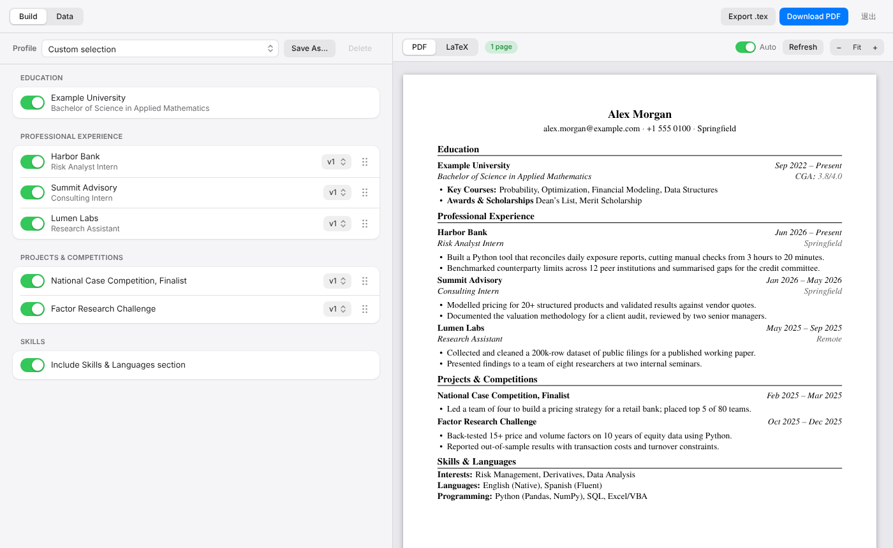
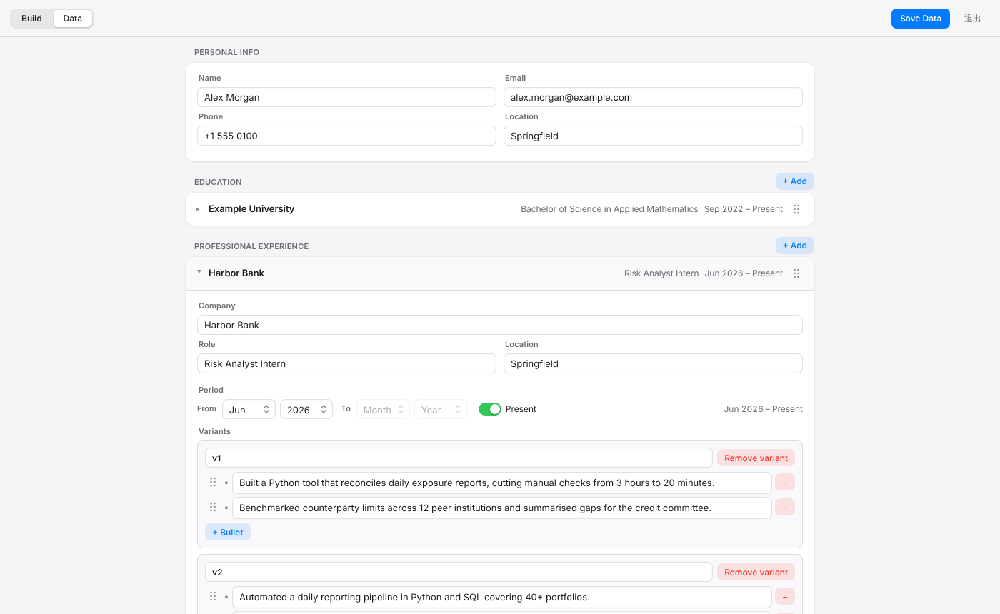

# CV Builder

一个本地运行的简历生成器。你把经历、项目、教育背景录入一次,之后针对不同岗位**勾选、排序、选择措辞版本**,就能生成排版统一的 PDF 简历。

适合需要同时投递多类岗位的人:同一段经历可以保存多个写法(例如偏风控 / 偏量化),每次投递只需要重新组合,不必复制粘贴多份 Word 文档。



- **模块化**:内容和排版分离,经历只录入一次,按岗位自由组合
- **多版本措辞**:同一条经历可以有多组 bullet,按需切换
- **实时预览**:选择变化后右侧自动刷新真实的 PDF,并显示页数
- **本地优先**:数据保存在你自己的电脑上的 YAML 文件里,不上传任何服务器
- **LaTeX 排版**:使用 XeLaTeX 生成,版式整洁,可导出 `.tex` 继续手改
- **桌面应用**:独立窗口,跟随系统浅色 / 深色模式

## 工作方式

```
cv_data.yaml        你的全部素材(个人信息、教育、经历、项目、技能,每条经历含多个版本)
      +
profile             一次投递的选择:用哪些条目、各用哪个版本、什么顺序
      ↓
  生成 LaTeX  →  xelatex / Tectonic 编译  →  PDF
```

界面有两个页面:

- **Data**:维护素材库。
- **Build**:挑选要放进简历的条目、选版本、调顺序,右侧即时预览;满意后导出 PDF 或 `.tex`。常用组合可以存成命名的 **profile**(如 `risk`、`consulting`),之后一键切换。



## 快速试用

1. 安装依赖并启动(见下一节)。
2. 想先看看效果,把 [`examples/cv_data.sample.yaml`](examples/cv_data.sample.yaml)(全部是虚构内容)复制到数据目录,命名为 `cv_data.yaml`,重启应用。数据目录见"数据位置"。
3. 在 Data 页换成你自己的内容,点 **Save Data**,回到 Build 页挑选并导出。

## 安装与运行

### 依赖

- Python 3.11 或 3.12
- 一个 LaTeX 引擎,二选一:
  - 本机安装 [MiKTeX](https://miktex.org/) 或 TeX Live(需含 `xelatex` 和 TeX Gyre Termes 字体)
  - 使用内置 [Tectonic](https://tectonic-typesetting.github.io/) 的构建版本,无需安装 TeX(**实验性**,见下)

### 从源码运行

```bash
pip install -r requirements.txt
python app.py                        # 弹出独立窗口
CV_BUILDER_BROWSER=1 python app.py   # 改用默认浏览器打开(调试用)
```

### 打包成 Windows 应用

```bat
build_windows.bat                  :: 使用本机已装的 xelatex
build_windows.bat --with-tectonic  :: 额外内置 Tectonic 和离线宏包缓存(实验性)
```

产物为 `dist\CV Builder\CV Builder.exe`,整个 `CV Builder` 文件夹即可分发。脚本会在项目目录里创建独立的 `.venv`,不会影响系统或 conda 环境。

窗口使用 Windows 自带的 WebView2(Windows 11 已预装;Windows 10 如缺失需安装 Microsoft Edge WebView2 Runtime)。窗口无法创建时会自动改用默认浏览器打开。

## 数据位置

| 运行方式 | 数据目录 |
|---|---|
| 源码运行 | 项目文件夹 |
| 打包后的应用 | `%APPDATA%\CV Builder\` |
| 打包后,且 exe 同目录下有 `cv_data.yaml` | exe 所在目录(便携模式) |
| 设置了环境变量 `CV_BUILDER_DATA` | 该变量指定的目录 |

| 文件 | 说明 |
|---|---|
| `cv_data.yaml` | 全部素材 |
| `cv_profile_*.yaml` | 保存的 profile |
| `settings.json` | 界面设置 |
| `output/` | 编译产物 |
| `backups/` | 每次保存素材前的备份 |
| `app.log` | 运行日志 |

首次运行会生成一份空白的 `cv_data.yaml`。这些文件都在 `.gitignore` 中,不会被提交。

## 数据格式

`cv_data.yaml` 是纯文本,也可以直接用编辑器修改。完整示例见 [`examples/cv_data.sample.yaml`](examples/cv_data.sample.yaml),结构如下:

```yaml
template:
  font: TeX Gyre Termes          # 正文字体
personal:
  name: Your Name
  email: you@example.com
  phone: "+00 000 0000"
  location: City
education:
  - id: uni1                     # 内部标识,profile 用它引用该条目
    institution: Example University
    degree: BSc in Something
    cgpa: 3.80/4.00
    start: 2024-09               # 年-月
    end: present                 # 年-月,或 present
    courses: Course A, Course B
    awards: Dean's List
experiences:
  intern1:                       # 条目 id
    company: Example Bank
    role: Analyst Intern
    location: City
    start: 2026-06
    end: present
    variants:                    # 同一经历的多个写法
      v1:
        - First bullet.
        - Second bullet.
      v2:
        - Alternative wording.
projects:
  proj1:
    title: Case Competition
    start: 2025-02
    end: 2025-03
    variants:
      v1:
        - What you did.
skills:
  Interests: A, B, C
  Languages: English (Fluent)
```

profile 文件(`cv_profile_<name>.yaml`)记录一次投递的选择:

```yaml
education: [uni1]
experiences: ["intern1:v1", "other1:v2"]   # 条目:版本,顺序即简历中的顺序
projects: ["proj1:v1"]
include_skills: true
```

文本里的 `& % $ # _ { } ~ ^ \` 等 LaTeX 特殊字符会自动转义。

## LaTeX 引擎

- 优先使用系统的 `xelatex`,没有时使用 Tectonic。
- 环境变量:`CV_XELATEX` / `CV_TECTONIC` 指定可执行文件路径;`CV_ENGINE=tectonic` 强制使用 Tectonic。
- 编译在后台隐藏窗口中运行,带超时保护(预览 60 秒、导出 120 秒),超时会结束整个子进程树。
- 编译失败时,预览区顶部会显示原因(缺字体、缺宏包、LaTeX 报错及行号)。
- **Tectonic 支持为实验性功能**:引擎调用流程已通过测试,但尚未在真实 Windows 环境完整验证。它首次编译需要联网下载宏包,用 `--with-tectonic` 构建会预先下载并随应用分发。

## 项目结构

```
├── app.py                 # Flask 后端 + 原生窗口(pywebview)
├── generate_cv.py         # LaTeX 生成、日期处理、PDF 编译
├── templates/index.html   # 页面外壳
├── static/                # 前端脚本、样式、PDF.js、字体、图标
├── cv_data.example.yaml   # 首次运行时生成的空白数据
├── examples/              # 虚构的示例数据
├── docs/                  # 截图
├── build_windows.bat      # Windows 一键打包
├── build_app.spec         # PyInstaller 配置
├── assets/app.ico         # 应用图标
└── tools/                 # Tectonic 离线缓存预热脚本
```

## 常见问题

**提示找不到 LaTeX 引擎** — 安装 MiKTeX / TeX Live,或设置 `CV_XELATEX`,或使用 `--with-tectonic` 构建的版本。

**提示找不到字体 TeX Gyre Termes** — MiKTeX 用户在 MiKTeX Console 里安装 `tex-gyre` 包;或在 `cv_data.yaml` 的 `template.font` 改成本机已安装的字体。

**应用启动后没有窗口** — 查看数据目录里的 `app.log`;系统缺少 WebView2 时程序会改用浏览器打开。

## 限制

- 目前只有一套模板。
- 默认字体不含中文字形,暂不支持中文内容。

## 许可

本项目以 [MIT 许可证](LICENSE) 发布。内置的第三方资源:PDF.js(Apache-2.0)、Inter 字体(SIL OFL 1.1),许可文件位于 `static/` 下对应目录。
