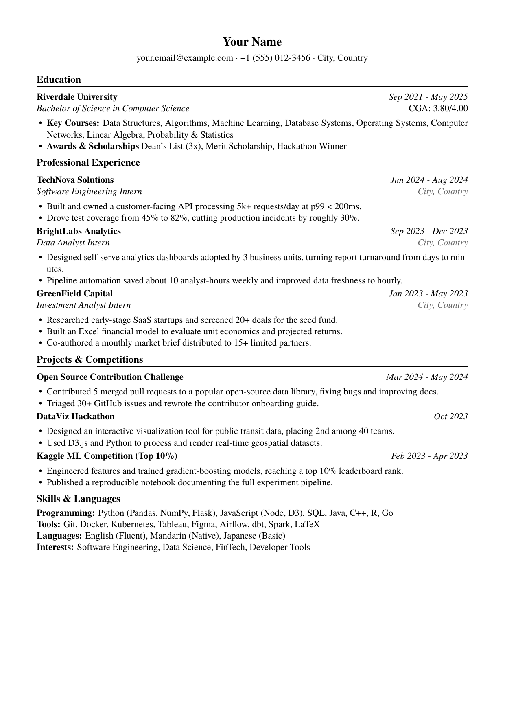

# CV Builder

## What it does

- Keep all CV content (education, experiences, projects, skills) in `cv_data.yaml`.
- Give each experience or project multiple bullet variants, for example a finance-facing version and a tech-facing version.
- Use the web UI to check items, switch variants, reorder them, and preview the LaTeX live.
- Compile the selected profile to a PDF via xelatex in one step.

## Example

Rendered from `cv_profile_full.yaml` using the bundled fictional sample data:

The content lives in `cv_data.yaml`. Switch variants or reorder items in the web UI or a profile YAML, then recompile.

## Sample data

The repository ships `cv_data.yaml` (fictional sample) and `cv_profile_full.yaml` (a ready-made profile that selects items and variants). Replace the `personal` block with your own details before building a real CV, and do not commit your real data to a public repository.

## Requirements

- Python 3.10 or newer
- A TeX distribution providing xelatex (MiKTeX or TeX Live), with `xelatex` on your PATH — you configure the environment yourself
- The TeX Gyre Termes font is bundled in `fonts/` — no separate install needed
- Python packages listed in `requirements.txt`

## Run the web UI

    pip install -r requirements.txt
    python app.py

Then open http://127.0.0.1:5000

## Use the command line

List everything available:

    python generate_cv.py --list

Generate a .tex file and compile it to PDF for a profile:

    python generate_cv.py --profile cv_profile_full.yaml --out output/cv.tex --pdf

## License

Released under the MIT License. See LICENSE.
